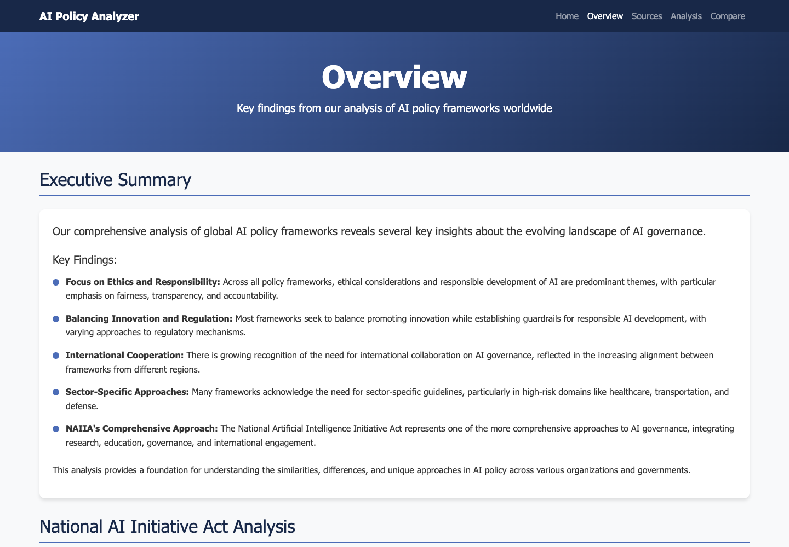
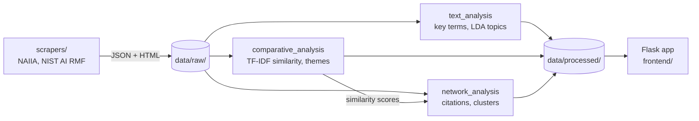

# AI Policy Analyzer

A Python pipeline and Flask web app for studying the National Artificial Intelligence Initiative Act (NAIIA) and related AI governance frameworks. It scrapes policy pages, runs text, similarity and network analysis on what it collects, and shows the results in a small web interface.

## Sample-data preview



The screenshot shows `/overview` with the sample data from [run_demo.py](run_demo.py), captured on 2026-09-12. The bundled text and numbers are demonstration content, not results from a fresh scrape.

After installing the dependencies (see [Installation](#installation)), run the demo from the repository root:

```sh
python run_demo.py
```

Open `http://localhost:5000/overview` or inspect `http://localhost:5000/api/results`. The script writes its fixtures into `data/raw` and `data/processed`, replacing files with the same names. Use a fresh clone if you already have collected data.

`start.sh` (macOS/Linux) and `start.bat` (Windows) do the same in one step: they create a `venv`, install `requirements.txt` into it and run the demo.

## How it works



`main.py` runs the stages. Each one reads and writes JSON files under `data/`, so they can be run separately.

## Data sources

[`scrapers/__init__.py`](scrapers/__init__.py) lists 14 sources in `DATA_SOURCES`, and the `/sources` page shows all of them. Two have scrapers so far:

| Scraper | Pages it fetches |
| --- | --- |
| [`naiia_scraper.py`](scrapers/naiia_scraper.py) | ai.gov's NAIIA page: overview, sections, key provisions and related resources |
| [`nist_ai_scraper.py`](scrapers/nist_ai_scraper.py) | NIST's AI Risk Management Framework pages: overview, core framework, resources and news |

The others (NAIIO, NAIRR Task Force, NITRD, NSF AI Institutes, DOE AITO, OSTP, OECD.AI, GPAI, UNESCO, the EU AI Act, WEF and Stanford HAI) are listed but not scraped. Any module in `scrapers/` whose name ends in `_scraper` and that defines `run_scraper()` is picked up automatically and run in parallel.

## What the analysis does

- **Text analysis** ([`analysis/text_analysis.py`](analysis/text_analysis.py)): tokenizes and lemmatizes the scraped text with NLTK, ranks key terms per source and overall, and fits an LDA topic model (scikit-learn).
- **Comparative analysis** ([`analysis/comparative_analysis.py`](analysis/comparative_analysis.py)): TF-IDF cosine similarity between sources, shared policy themes, and the terms that set each source apart.
- **Network analysis** ([`analysis/network_analysis.py`](analysis/network_analysis.py)): finds which sources mention each other and groups similar sources into clusters.
- **Web interface** ([`frontend/`](frontend/)): Home, Overview and Sources pages, plus `/api/results` and `/api/visualizations` JSON endpoints.

## Installation

```bash
git clone https://github.com/cadeKukk/ai_policy_analyzer.git
cd ai_policy_analyzer

python3 -m venv venv
source venv/bin/activate  # On Windows: venv\Scripts\activate

pip install -r requirements.txt
```

The versions pinned in `requirements.txt` date from 2023 and don't install on Python 3.13 or newer (pandas 2.1.3 has no wheels there). On a current Python, install the packages the code imports instead:

```bash
pip install flask requests beautifulsoup4 pandas scikit-learn nltk
```

That set was checked with Python 3.14 on 2026-11-03: the demo serves its pages, and the analysis stage runs on the sample data once the first issue under [Known issues](#known-issues) is fixed.

## Usage

```bash
python main.py --scrape    # fetch the sources into data/raw/
python main.py --analyze   # write analysis results to data/processed/
python main.py --serve     # start the web interface on http://localhost:5000
python main.py --all       # all three in order
```

Running `python main.py` with no flags is the same as `--all`. Each run also writes a `logs_YYYYMMDD.log` file in the repository root. The text analysis downloads the NLTK data it needs on first run.

## Known issues

- `--analyze` (and so `--all` and a bare `python main.py`) stops with `ModuleNotFoundError: No module named 'analysis.visualization'`: [`analysis/__init__.py`](analysis/__init__.py) imports `generate_visualizations` from the analysis package, but it lives in [`frontend/visualization.py`](frontend/visualization.py).
- `analyze_all_data()` runs network analysis before comparative analysis, so network analysis uses the similarity scores from the previous run (none on the first run).
- `/api/visualizations` returns `null`, because `generate_visualizations()` builds its result but doesn't return it.
- The Analysis and Compare pages (`/analysis`, `/compare`) return a 500 error: their templates (`analysis.html`, `compare.html`) are not in `frontend/templates/`.

## Project structure

```
main.py                  command-line entry point (--scrape, --analyze, --serve, --all)
run_demo.py              writes sample data and starts the web interface
start.sh, start.bat      set up a venv and run the demo
scrapers/                base scraper, source list and the two scrapers
analysis/                text, comparative and network analysis
frontend/                Flask app, templates and visualization data
Manim GL Animations/     ManimGL scenes on AI policy (see below)
docs/screenshots/        README images
```

`data/` is created at runtime and is not committed.

### Manim GL Animations

Seven [ManimGL](https://github.com/3b1b/manim) scenes, separate from the analyzer:

| File | Scene |
| --- | --- |
| `nationalAI.py` | `NationalAIInitiativeAct` |
| `AIact.py` | `AIGovernanceStructure` |
| `AIadvance.py` | `AIInvestmentGraph` |
| `AIset.py` | `AIResearchCenters` |
| `AIper.py` | `ModelsByCountryChart` |
| `eff.py` | `ComputationalPowerComparison` |
| `ters.py` | `AISourcesScene` |

With ManimGL installed, render one with `manimgl "Manim GL Animations/nationalAI.py" NationalAIInitiativeAct`.

## Extending the application

### Adding a data source

1. Add the source to `DATA_SOURCES` in [`scrapers/__init__.py`](scrapers/__init__.py).
2. Create `scrapers/<name>_scraper.py` following the existing scrapers (subclass `BaseScraper` from [`base_scraper.py`](scrapers/base_scraper.py)).
3. Give the module a `run_scraper()` function.

### Adding an analysis method

1. Create a module in [`analysis/`](analysis/).
2. Call it from `analyze_all_data()` in [`analysis/__init__.py`](analysis/__init__.py).
